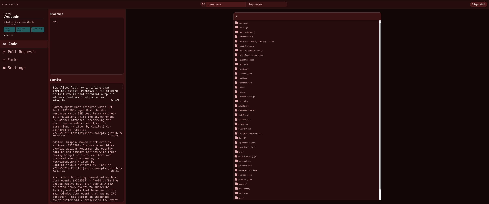
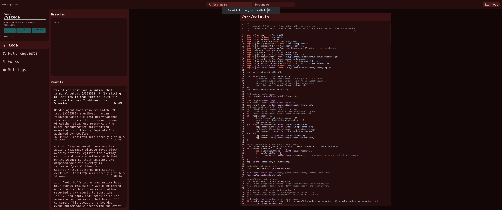

# Gitogether


**Contents**
1. [Overview](#overview)
1. [Usage](#usage)

## Overview
With GitHub growing less reliable these days, I wanted a backup, open-source solution for hosting personal projects. I came across Gitea and thought, why not try creating one myself?

Gitogether is a Git repository hosting platform made with FastAPI, PostgreSQL, and HTMX. Users can create accounts to collaborate on projects while using Git to manage local and remote versions of repositories. Collaboration features include:
* Creating pull-requests from forks or the repo itself.
* Viewing pull-request diffs.
* Forking repositories.
* Repository #tags.

For more on how this project works, visit my [portfolio](https://sidney-bernardin.github.io).

<div style="display: flex">
  
  
</div>


## Usage

### Install and run Gitogether and it's database.

1) Clone this repository.
``` bash
git clone https://github.com/Sidney-Bernardin/Gitogether.git
cd Gitogether
```

2) Run the app and Postgres services.
``` bash
docker compose up --build
```

3) From there, you can create an account and try opening a pull-request.
